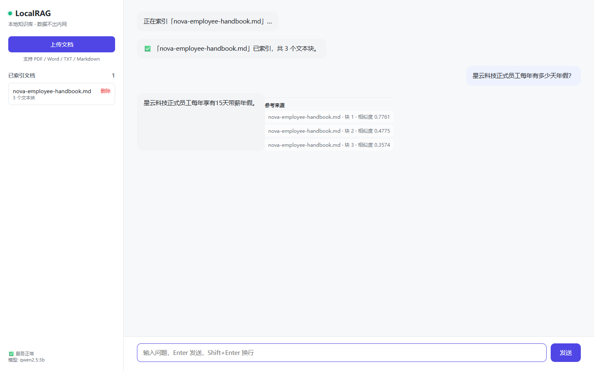
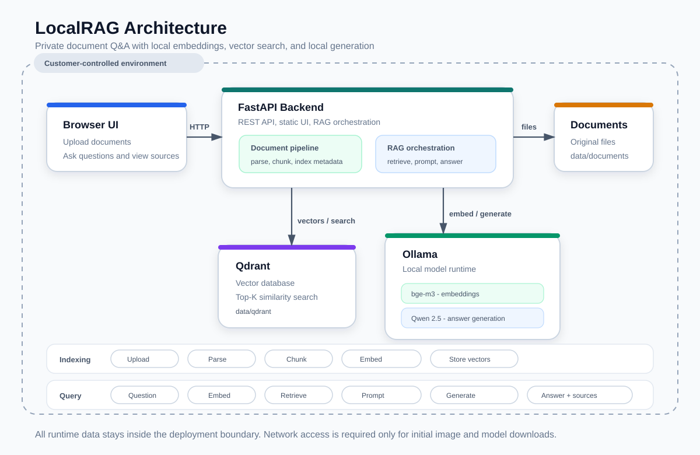

# LocalRAG

**[English](README.md) | 简体中文** — **可私有化部署的本地知识库问答系统 —— 把你的文档喂给它，它基于你的资料回答问题，全程不联网。**

> ✅ 当前状态：**Docker 真实环境验证通过**（2026-10-15）
> 已验证：Qdrant / Ollama / FastAPI 三服务启动、文档索引、向量检索、问答返回来源。

**官网**：<https://pingredsai.github.io/local-rag/>

---

## 为什么需要它

| 场景 | 问题 |
|---|---|
| 律所 | 案件材料涉密，不能上传到任何云端 |
| 诊所/医院 | 患者隐私受法规保护 |
| 财税/审计 | 客户财务数据敏感 |
| 制造业 | 工艺配方是核心资产 |
| 涉密单位 | 强制内网隔离 |

**这些单位的共同点：想让 AI 基于内部资料回答问题，但数据一步都不能出内网。**

**云端 AI 服务在这里是不可选项。LocalRAG 填的就是这个位置。**

---

## 它能做什么

- 📄 **上传文档** → 自动解析、切块、向量化、入库
- 💬 **提问** → 基于你的文档回答，**并附带来源**
- 🔒 **完全离线** → 不依赖任何外部 API
- 🚀 **一键启动** → `docker compose up -d`

**支持的文档格式**：PDF（文本型）、Word (.docx)、TXT、Markdown

---

## 快速开始

### 前置要求

- Docker + Docker Compose
- 内存：建议 8GB 以上
- 磁盘：建议 20GB 以上（模型 + 数据）

### 三步跑起来

```bash
# 1. 复制配置
cp .env.example .env

# 2. 启动（首次会拉取镜像和模型，可能较慢）
docker compose up -d

# 3. 拉取模型（两个都要）
docker exec localrag-ollama ollama pull qwen2.5:3b
docker exec localrag-ollama ollama pull bge-m3
```

**然后打开浏览器**：http://localhost:8080
> 💡 国内网络提示：官方 `ollama/ollama:latest` 很大（压缩约 3.6GB，本地展开约 9GB）。本项目已固定为兼容的 `0.11.3`（压缩约 1.1GB）；Docker 拉取慢时可用国内镜像加速。

### 验证

```bash
# 看服务状态
docker compose ps

# 看后端日志
docker compose logs -f backend

# 健康检查
curl http://localhost:8080/api/health
```

### 实测记录（2026-10-15）

- Docker Desktop 4.95.0 + Ollama 0.11.3 + Qdrant 全部启动成功。
- 演示资料 `nova-employee-handbook.md` 成功切分为 3 个文本块。
- 年假、远程办公、信息安全问题均返回正确结果，并显示来源和相似度。

### 演示素材

- [MP4 演示视频](demo/video/localrag-demo.mp4)（约 42 秒）
- 截图：`docs/screenshots/03-answer-with-source.png`
- 完整演示脚本：`docs/demo-script.md`


**健康的返回应该类似：**

```json
{"status":"ok","qdrant":"ok","ollama":"ok","llm_model":"qwen2.5:3b","embed_model":"bge-m3"}
```

---

## 使用流程

```
1. 打开 http://localhost:8080
2. 点「上传文档」→ 选择 PDF / Word / TXT
3. 等待索引完成（会显示切了多少块）
4. 在右边输入问题 → 它会基于你上传的文档回答
```

---

## 架构



详细说明见 [`docs/architecture.md`](docs/architecture.md)。

**两个核心流程：**

**索引（上传时）：**
```
文档 → 解析 → 切块 → 向量化 → 存入 Qdrant
```

**问答（提问时）：**
```
问题 → 向量化 → 检索 Top-K 相关块 → 拼接 → LLM 生成 → 返回答案 + 来源
```

---

## 配置

编辑 `.env`：

```ini
# 嵌入模型
EMBED_MODEL=bge-m3

# 大模型（小机器用 3b，有 GPU 可换 14b / 32b）
LLM_MODEL=qwen2.5:3b

# 检索参数
TOP_K=5
```

**模型选择建议：**

| 硬件 | 推荐模型 | 说明 |
|---|---|---|
| 笔记本 / 无 GPU | `qwen2.5:3b` | 约 2GB，能跑 |
| 8GB 显存 | `qwen2.5:7b` | 质量明显提升 |
| 24GB 显存 | `qwen2.5:14b` | 接近可用生产 |
| 48GB+ 显存 | `qwen2.5:32b` | 质量最好 |

---

## API

| 方法 | 路径 | 说明 |
|---|---|---|
| GET | `/api/health` | 健康检查 |
| POST | `/api/documents/upload` | 上传并索引文档 |
| GET | `/api/documents` | 列出已索引文档 |
| DELETE | `/api/documents/{id}` | 删除文档及索引 |
| POST | `/api/chat` | 提问（非流式） |
| POST | `/api/chat/stream` | 提问（流式） |

**示例：**

```bash
curl -X POST http://localhost:8080/api/chat \
  -H "Content-Type: application/json" \
  -d '{"question":"合同违约了怎么办？"}'
```

---

## 离线部署（企业场景）

**这套系统设计时就考虑了"永久离线"**，因为目标客户基本都有内网隔离要求。

**离线部署步骤：**

```bash
# 1. 在有网的机器上准备一切
docker compose pull
docker save -o images.tar \
    qdrant/qdrant:latest \
    ollama/ollama:0.11.3 \
    localrag-backend:latest

# 2. 导出模型
docker run --rm -v $(pwd)/data/ollama:/data ollama/ollama \
    tar -cf /data/models.tar /data/models

# 3. 拷贝 images.tar + models.tar + 整个项目目录到内网机器
# 4. 在内网机器上
docker load -i images.tar
docker compose up -d
```

**需要检查的"联网点"：**

- [ ] 前端是否引用了 CDN 资源（当前版本**没有**，全部本地）
- [ ] 后端是否有遥测或更新检查（当前版本**没有**）
- [ ] 模型是否全部本地（当前版本**是**）
- [ ] Docker 镜像是否全部预拉取
- [ ] 字体是否本地（当前使用系统字体）

---

## 项目结构

```
local-rag/
├── docker-compose.yml
├── .env.example
├── LICENSE                      MIT
├── SECURITY.md                  安全报告说明
├── package.json                 演示工具依赖
├── README.md                    英文说明
├── README.zh-CN.md              中文说明
├── docs/
│   ├── architecture.md         架构说明
│   ├── architecture.svg        架构图
│   ├── demo-script.md          演示脚本
│   └── screenshots/            演示截图
├── demo/
│   ├── nova-employee-handbook.md
│   └── video/localrag-demo.mp4
├── scripts/
│   └── capture-localrag.cjs    自动截图/录屏
├── backend/
│   ├── Dockerfile
│   ├── requirements.txt
│   └── app/
│       ├── main.py              FastAPI 入口
│       ├── config.py            配置
│       ├── api/                 接口层
│       │   ├── health.py
│       │   └── chat.py
│       ├── models/schemas.py    数据模型
│       └── services/            核心逻辑
│           ├── parser.py        文档解析
│           ├── chunker.py       文本切块
│           ├── embedder.py      向量化
│           ├── vectorstore.py   向量库
│           ├── generator.py     LLM 生成
│           └── rag.py           编排
├── frontend/                    纯静态页面
│   ├── index.html
│   ├── app.js
│   └── style.css
└── data/                        运行时数据（不入库）
    ├── documents/
    └── qdrant/
```

---

## 常见问题

**Q: 拉模型很慢怎么办？**
A: `qwen2.5:3b` 约 2GB，`bge-m3` 约 1.2GB。可以用国内镜像源，或者提前在有网机器上下好再拷过去。

**Q: 支持扫描件 PDF 吗？**
A: **当前版本不支持**。扫描件需要 OCR（计划中，但会显著增加部署体积）。

**Q: 回答质量不好怎么办？**
A: 按顺序尝试：① 换更大的模型 ② 提高 `TOP_K` ③ 优化文档质量（切块前先清理）④ 加入 Reranker。

**Q: 能同时支持多个知识库吗？**
A: 当前版本是单一知识库。多库隔离是后续功能。

**Q: 支持 GPU 加速吗？**
A: 支持。在 `docker-compose.yml` 里取消 Ollama 的 GPU 配置注释即可（需要 NVIDIA Container Toolkit）。

---

## 开发状态

| 功能 | 状态 |
|---|---|
| 文档上传与索引 | ✅ 已实现 |
| 向量检索问答 | ✅ 已实现 |
| 来源引用 | ✅ 已实现 |
| 流式输出 | ✅ 已实现 |
| Web 界面 | ✅ 已实现 |
| 一键 Docker 部署 | ✅ 已实现 |
| 英文 README + 架构图 | ✅ 已完成 |
| **真实环境验证** | ✅ 2026-10-15 通过（上传→索引→检索→回答） |
| Reranker 重排 | 🔲 计划中 |
| OCR 扫描件 | 🔲 计划中 |
| 多知识库 | 🔲 计划中 |
| 权限管理 | 🔲 计划中 |

---

## 许可

MIT License

---

## 联系

- GitHub: https://github.com/Pingredsai
- 邮箱: siquhjh@163.com