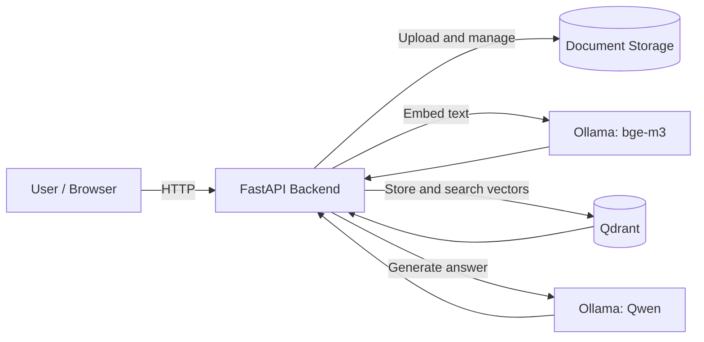
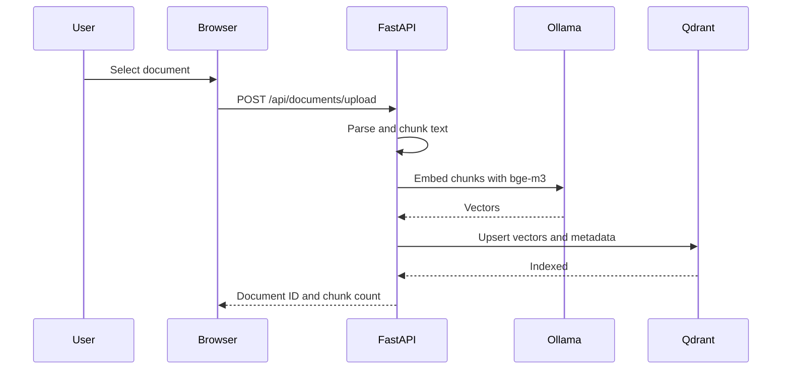
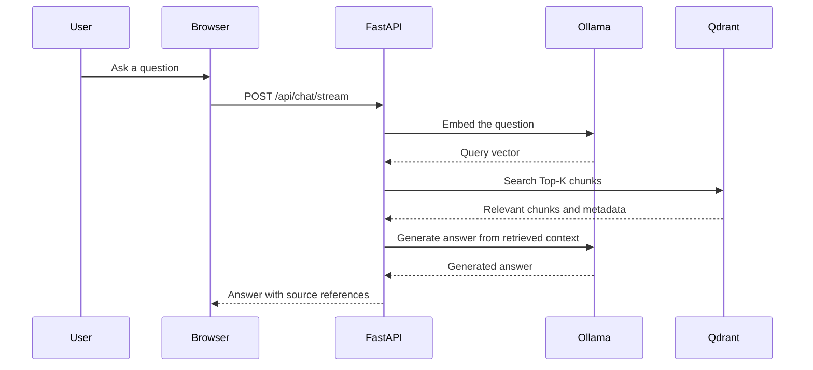

# LocalRAG Architecture

## System context

LocalRAG runs inside a customer-controlled network. The browser talks only to the FastAPI application. FastAPI uses Qdrant for vector storage and Ollama for local embeddings and text generation.

## Container view

## Indexing flow

## Query flow

## Components

| Component | Responsibility | Storage |
|---|---|---|
| Browser UI | Upload documents, ask questions, display answers and sources | None |
| FastAPI backend | Parsing, chunking, RAG orchestration, REST API, static files | Document volume |
| Qdrant | Vector persistence and similarity search | `data/qdrant` |
| Ollama | Local embedding and generation runtime | `data/ollama` |
| Document storage | Original uploaded files | `data/documents` |

## Trust boundary

The important boundary is the customer network. At runtime:

- No document content is sent to a third-party AI API.
- No cloud vector database is used.
- No telemetry service is required.
- Docker images and Ollama models are prepared ahead of time for air-gapped installations.

Network access is required only during initial installation to pull images and models.